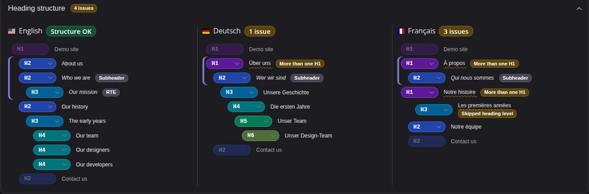
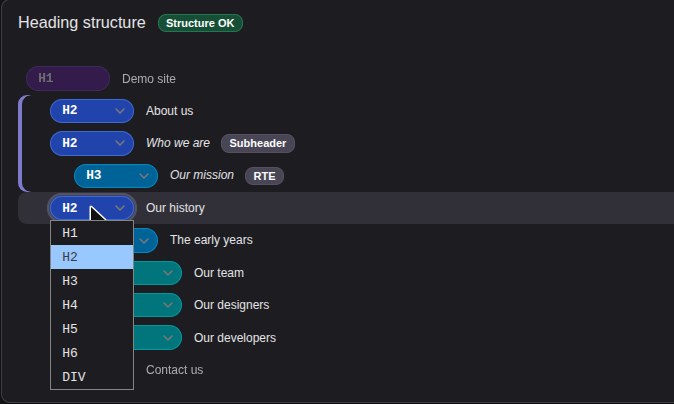
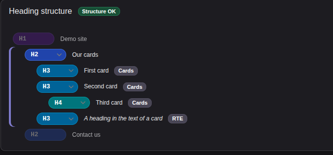

# headliner

**See the heading structure of every page right in the TYPO3 page module, and fix it in place.**

[](https://typo3.org)
[](https://www.php.net)
[](LICENSE)

`headliner` (`twtgroup/headliner`) shows the heading structure (H1-H6) of a page above the content in the page module
and points out problems: a missing or repeated H1, skipped levels (an H2 followed by an H4) and empty headings. The tag
of a header can be changed right there, without touching the look of the page.



The full documentation is in [`Documentation/`](Documentation/Index.rst).

**Contents:** [Features](#features) · [Installation](#installation) · [Setup](#setup) ·
[Your templates](#in-your-own-templates) · [Extending](#extending-with-your-own-rules) · [Compatibility](#compatibility) · [Migration](#migration) ·
[Requirements](#requirements) · [Contributing](#contributing)

## Features

### The box in the page module

- A box above the content that can be collapsed (the state is remembered per backend user, so it stays collapsed on
  other pages).
- It loads after the page module, also while collapsed, so the summary shows the problems and checking the page does
  not delay the page module.
- The headings of one content element are drawn as a group (a coloured bar on the left; hovering one marks the others
  and the element below). A subheader has the badge "Subheader".
- It updates itself when content changes in the page module: hide or show an element, or move it by drag and drop, and
  the structure is checked again.
- With the language comparison of the page module the box has one section per selected language, side by side like the
  columns of the page module; if they do not fit, it scrolls sideways.

### Changing and opening headings

| Heading                                       | Badge            | What you can do in the box |
|-----------------------------------------------|------------------|----------------------------|
| Header or subheader of a content element      |                  | Change the tag with a select (H1-H6 or div); it is saved with the rights of the backend user and the structure is checked again. A click on the text opens the element in the side panel, as the edit button of the page module does. |
| Text of a content element (RTE)               | `RTE`            | Open the element. With the site setting `headliner.editRteHeadings` (off by default) also change the tag, to the headings the RTE preset offers (`heading.options`, H2 and H3 in the default preset), at the place of the heading in the stored text. If the heading is not found there with the same text, it stays a label. |
| Field of a child record (a card of a block)   | name of the table | Change the tag, see [Content Blocks](#content-blocks). |
| Menu, footer and other sources                |                  | Shown only. |



The select and the link appear only for backend users who may edit the element. Changing the tag also needs the
permission for the field *Tag* / *Subheader tag* (*Allowed excludefields* in the backend user group).

### Which headings are checked

- The content of the page is the elements of the site setting `headliner.contentSelector` (empty by default: the whole
  page). Without a matching element the whole page is checked.
- Headings in the header, the menu and the footer are shown very pale, and only their H1 counts: an H1 outside of the
  content is an H1 of the page, even if the editor cannot change it. Their other levels cause no problem, but an empty
  heading is a problem wherever it is.

### How the page is read

- The headings come from the rendered frontend of the page, rendered inside the running PHP process. There is no HTTP
  request, so a firewall, Basic Auth, TLS settings or a CDN in front of the site do not matter.
- Content elements, RTE content and other extensions are included without any configuration. Only standard pages are
  checked.
- A hidden page is rendered too, so you can check it before it is published.
- A page with a start or end time is rendered at a time when it is published; a page for frontend user groups is rendered
  as a member of them; in a workspace the box shows the versions of that workspace.

### Fields of the content elements

- **Tag** (H1-H6 or div, or "from the layout", the default, which is what content did before). It decides the HTML tag
  of the header, so the hierarchy can be fixed without touching the look: the layout (**Type**) only sets the CSS class
  `ce-headline-layout-N`.
- **Subheader tag**, the same for the subheader. The subheader has no layout of its own, it looks like its header
  ("Hidden" hides both). Without the field (see the site setting below) the subheader is rendered one level below the
  header.

## Installation

```bash
composer require twtgroup/headliner
```

Or download the extension from the [TYPO3 Extension Repository](https://extensions.typo3.org/extension/headliner) and
install it with the Extension Manager.

## Setup

Add the site set **Headliner** (`twtgroup/headliner`) to your site and clear the caches (the site sets and the TypoScript
are cached). `fluid_styled_content` is optional:

- **With it** (its set `typo3/fluid-styled-content` on the site as well) the set overrides the header partial of
  `fluid_styled_content`, so its content elements use the fields *Tag* and *Subheader tag*. The set loads
  `fluid_styled_content` before itself.
- **Without it** the set has the site settings and the page TSconfig only, and nothing is reported or logged. The tags
  in the frontend come from the ViewHelpers in your own templates. The box in the page module works the same.

> [!NOTE]
> Installing the package alone changes nothing in the frontend; the site set does. The fields *Tag* and *Subheader tag* and
> the box are there once it is installed, but the fields have no effect in the frontend without the set.
>
> With `fluid_styled_content`: content without a tag (the field is empty by default, also in the database) keeps the old behaviour (layout 1-6 =
> H1-H6), so existing pages do not change until an editor chooses a tag.
>
> This holds for the tags of the headers and of the subheaders: for content without a tag they are the same as with
> `fluid_styled_content` (a subheader is one level below its header). The one difference is a subheader under the layout 6,
> which `fluid_styled_content` makes an `h3` and headliner a `div` (nothing is below H6). The markup gets the class
> `ce-headline-layout-N` in addition.

### Site settings

| Setting                       | Default | Description |
|-------------------------------|---------|-------------|
| `headliner.subheader.enabled` | on      | Show the field *Subheader tag*. If switched off for a site, it is hidden in the backend and the subheader follows the tag of the header. |
| `headliner.editRteHeadings`   | off     | Allow the tag of a heading in the rich text of a content element to be changed in the box (only to the headings the RTE offers). The text of the element is changed, so it is off by default. |
| `headliner.contentSelector`   | empty   | CSS selector of the content of the page. The headings in it are checked; the ones around it are shown very pale and only their H1 counts. If nothing matches, or if empty, the whole page is checked. |

## In your own templates

The content elements of the core need nothing: the site set changes their header partial. For a template of your own
there are three ViewHelpers, by what you have:

| You have | Use |
|----------|-----|
| A record object (`{record}` in `fluid_styled_content`, `{data}` in a Content Block, a card) | `headliner:headline record="{record}"` |
| Values: an array, a partial without a record, a fixed heading | `headliner:headline.values tag="..." layout="..." edit="table:uid:field"` |
| The rich text of a row as an array (from a data processor) | `headliner:text row="{item.data}"` |

With the record the ViewHelper reads the tag and the layout, and names the record for the page module:

```html
<headliner:headline record="{record}" />
<headliner:headline record="{record}" subheader="1" />
<headliner:headline record="{card}" />
```

The text comes from the label field of the table (the `header` of a content element, the title of a card; `subheader` with
`subheader`), or from the field you name with `textField`, output with `f:render.text`, so
`visual_editor` still marks it. Text between the tags wins, for a link around it, say. A rich text field next to it needs
nothing: the headings the editor wrote in it are found by the page module on their own.

```html
<headliner:headline record="{record}" />
{record -> f:render.text(field: 'bodytext')}
```

The documentation (Integration) lists the arguments of each ViewHelper and how child records (cards) work.

## Extending with your own rules

The box checks four things: a missing H1, more than one H1, a skipped level and an empty heading. A project changes that
with the PSR-14 event `Twtgroup\Headliner\Event\ModifyHeadingIssuesEvent`. It is dispatched after the built-in rules,
once for each language the box shows.

| Method                                         | Does |
|------------------------------------------------|------|
| `getHeadings()`                                | The headings of the page, each with `level`, `text` and `outside`. |
| `getIssues()`                                  | The issues found so far. |
| `addIssue($type, $index, $label)`              | Add an issue (`$index` = `null` for a problem of the page). `$label` is plain text or an `LLL:` reference. |
| `removeIssues($type)`                          | Remove the issues of a rule (`missingH1`, `multipleH1`, `skippedLevel`, `emptyHeading`). |
| `setIssues($issues)`                           | Replace all issues. |

```php
use Twtgroup\Headliner\Event\ModifyHeadingIssuesEvent;
use TYPO3\CMS\Core\Attribute\AsEventListener;

#[AsEventListener]
final class HeadingTooLong
{
    public function __invoke(ModifyHeadingIssuesEvent $event): void
    {
        foreach ($event->getHeadings() as $index => $heading) {
            if (!$heading->outside && mb_strlen($heading->text) > 70) {
                $event->addIssue('myext.tooLong', $index, 'LLL:EXT:myext/Resources/Private/Language/locallang.xlf:headingTooLong');
            }
        }
    }
}
```

What a listener gives back is checked, and a listener that throws an exception does not take the box down (the built-in
issues are shown, the exception is logged). A slow listener is logged as a warning. The listener runs every time the page
module is opened, so keep it quick. More in the documentation (Developer).

## Compatibility

### Content Blocks

The Basics `Twtgroup/Headline` and `Twtgroup/Subheadline` give a block the header and subheader with their tags. The
headings of a block are grouped, and the headings of its collection records (cards) get a select for their tag and for
the headings in their rich text. Give `headliner:headline` the record: it reads the tag and names the record for the page
module itself. It finds the one tag field of the card, and a card without a tag is one level below the header of the
element. Nothing else is needed, the headings in the rich text of the card are found by themselves:

```html
<f:for each="{data.cards}" as="card">
    <headliner:headline record="{card}" />
    {card -> f:render.text(field: 'text')}
</f:for>
```

A record needs nothing else. A row as an array (from `database-query`, say) is no record: turn it into one with
the core's `record-transformation` data processor, or use `headliner:headline.values` for the title and `headliner:text`
for the rich text. The documentation (Integration) shows both.



The same works for child records made with the means of the core. See the documentation (Integration).

### Visual Editor

The header partial keeps the `f:render.text` calls of the partial of `fluid_styled_content`, which is how
[`visual_editor`](https://github.com/FriendsOfTYPO3/visual_editor) finds editable texts, so both extensions can be used
together. For the content elements of the core headliner needs no ViewHelper in your templates; the ViewHelpers
`headliner:headline`, `headliner:headline.values` and `headliner:text` are for your own templates.

### Themes with their own header

A theme that does not use the header partial of `fluid_styled_content` ignores the fields *Tag* and *Subheader tag* for
the content elements it renders itself. This was seen with the Regular Text Element of `typo3/theme-camino`: the box
shows their headings but cannot change their tag, and some of its own elements (Text Teaser, Text Media Teaser Grid)
render paragraphs instead of headings, so they do not appear in the box.

Where the theme uses the header partial of `fluid_styled_content` for an element (the `header` and `bullets` elements of
Camino), the site set replaces the markup of the theme for its headers: Camino's `<p class="headline headline--small">`
becomes `<h2 class="ce-headline-layout-2">`, so check the CSS of these elements.

The documentation (Integration) says how to hide the fields for such element types with page TSconfig
(`TCEFORM.tt_content.header_tag.types.<type>.disabled = 1`).

## Migration

Coming from the Semantilizer (`z7_semantilizer`)? The upgrade wizard `headlinerMigrateSemantilizerFields` takes its field
`header_type` into the tags of headliner:

```bash
vendor/bin/typo3 upgrade:run headlinerMigrateSemantilizerFields
```

See the documentation for what is left to do by hand.

## Requirements

- PHP **8.3+**
- TYPO3 **14.3 LTS**
- Optional: `fluid_styled_content`, for the header partial of its content elements

## Contributing

A ready-to-use DDEV demo instance and the test workflow:

```bash
ddev start                # installs dependencies and builds TYPO3 at https://headliner.ddev.site/
ddev test all && ddev lint
```

Backend login: `https://headliner.ddev.site/typo3/`, user `admin`, password `Password.1` (local demo only).

How to work on the extension, what a change needs and how to write a commit message: see
[CONTRIBUTING.md](CONTRIBUTING.md).

## License

This extension is released under the [GNU General Public License 2.0 (or later)](LICENSE).
